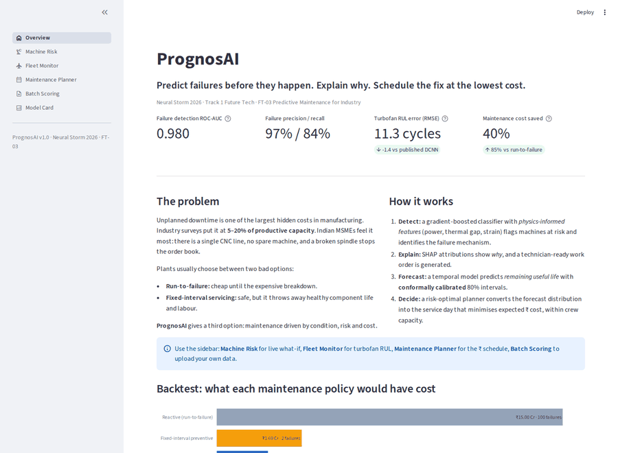
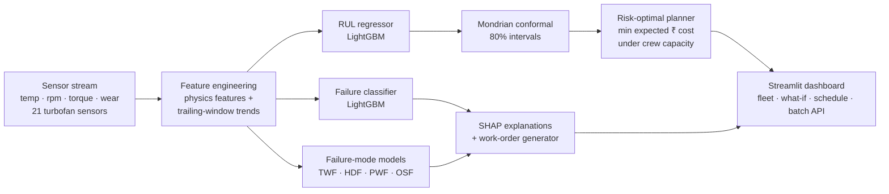
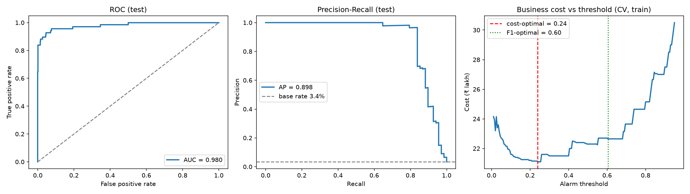
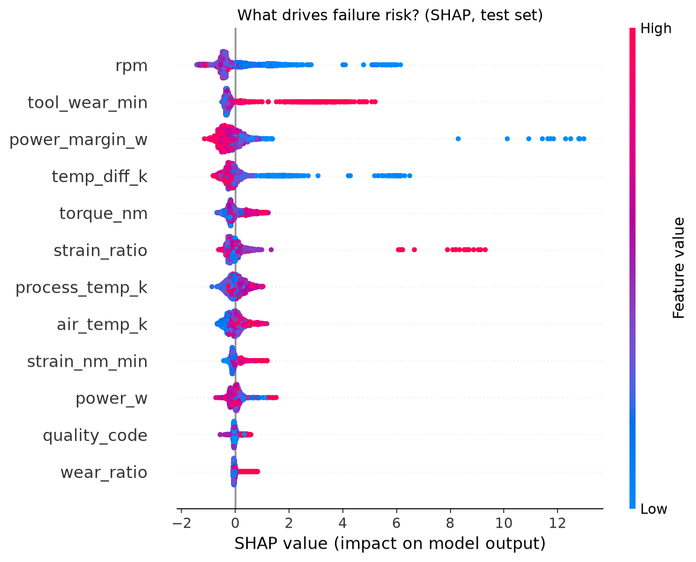
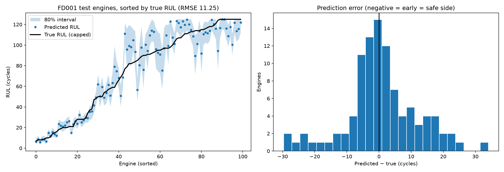
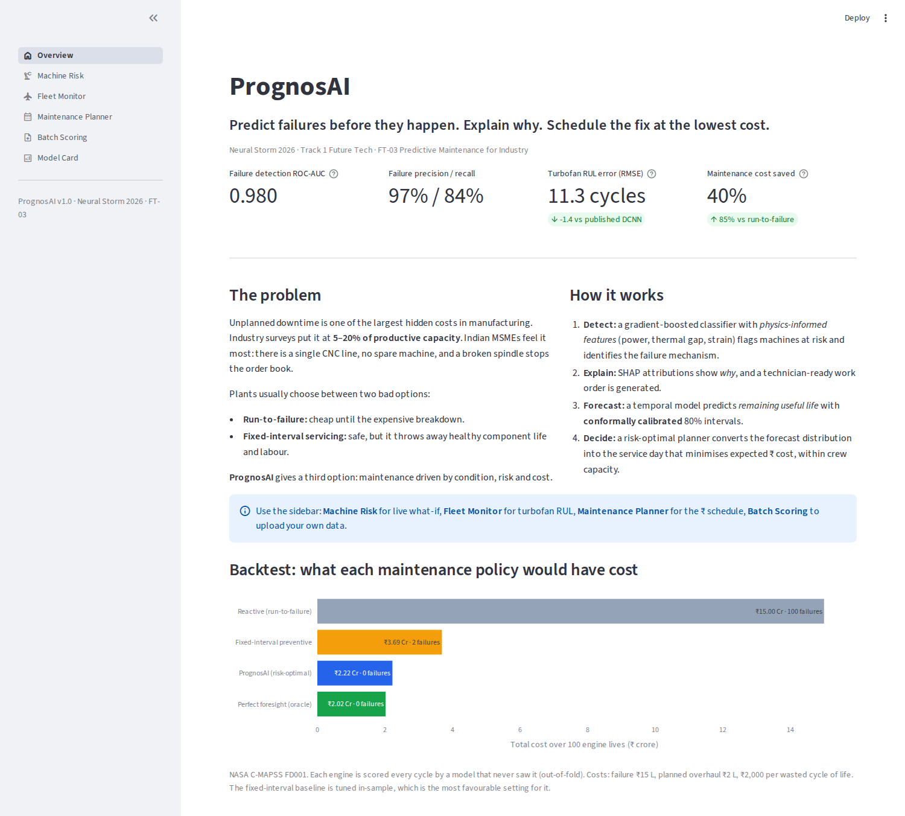
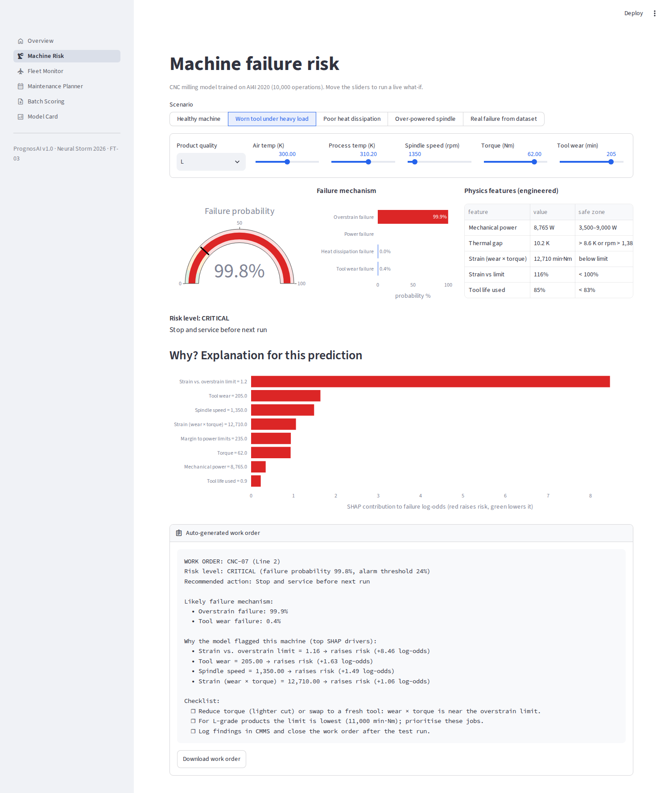
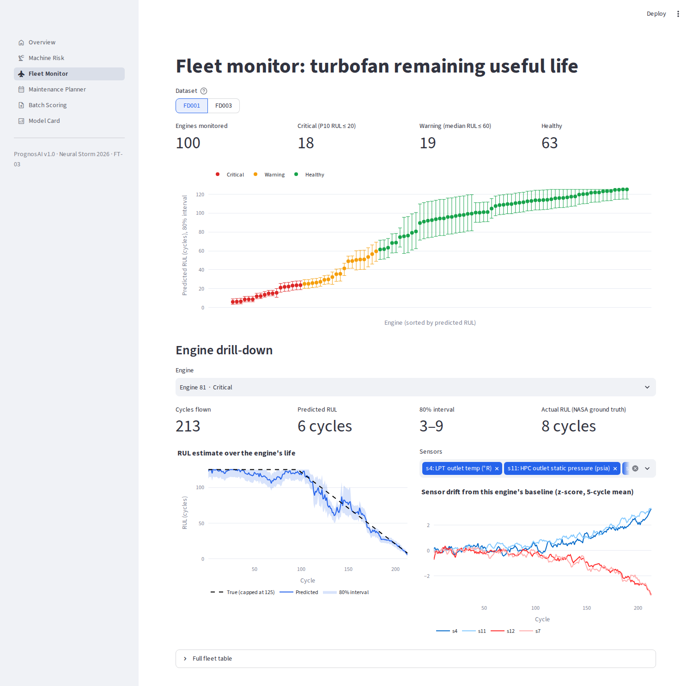
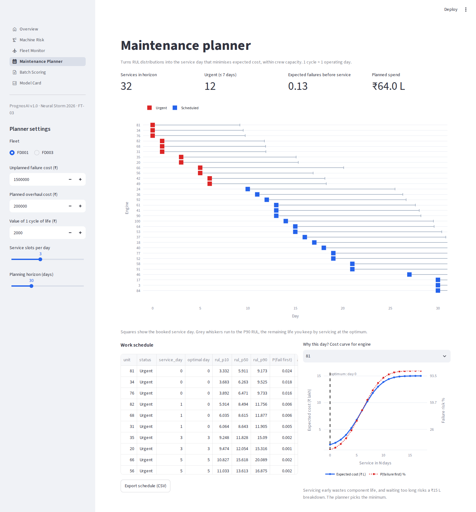

# PrognosAI: Explainable, Cost-Aware Predictive Maintenance

> **Predict failures before they happen. Explain why. Schedule the fix at the lowest cost.**

| | |
|---|---|
| **Hackathon** | Neural Storm 2026 |
| **Track** | Track 1: Future Tech (Intelligent Systems & Emerging Technology) |
| **Problem statement** | **FT-03: Predictive Maintenance for Industry** |
| **Team name** | Linear Asymptote |
| **Team members** | Sheheryar Ahmad (solo) |
| **Live demo** | **[https://hexa3.github.io/prognosai/](https://hexa3.github.io/prognosai/)**: the full app runs in your browser through WebAssembly, with no server and no install (first load about 30 s) |



---

## Results at a glance

All numbers come from **held-out test data** and are reproducible with two commands (see [Run it locally](#run-it-locally)).

| What | Metric | Result |
|---|---|---|
| Machine-failure detection (AI4I 2020, 2,000 test machines) | ROC-AUC / PR-AUC | **0.980 / 0.898** |
| | Precision / Recall / F1 | **96.6% / 83.8% / 0.898** |
| | Recall on heat, power & overstrain failures | **100% (58 of 58)** |
| | Business cost vs. no monitoring | **₹5.6 L vs ₹34 L (−84%)** |
| Remaining-useful-life forecast (NASA C-MAPSS FD001) | Test RMSE / MAE | **11.25 / 8.11 cycles** (better than published CNN 18.45, LSTM 16.14, DCNN 12.61) |
| | RMSE when the engine is ≤ 50 cycles from failure | **4.05 cycles** |
| | NASA PHM08 score | **189** (lower is better; DCNN 274) |
| RUL forecast (NASA C-MAPSS FD003, 2 fault modes) | Test RMSE / MAE | **10.31 / 6.86 cycles** (DCNN 12.64) |
| Uncertainty | 80% conformal interval, empirical coverage on 13k+ test rows | **81.7% (FD001) · 82.1% (FD003)** |
| **Business impact** | Maintenance cost vs. tuned fixed-interval schedule (100 engine lives) | **−40% (FD001) · −44% (FD003)** |
| | Failures over 100 engine lives (FD001) | **0** (fixed-interval: 2) |
| | Gap to a perfect-foresight oracle | **within 10% (FD001) · 15% (FD003)** |

---

## 1. Problem

Unplanned downtime is one of the largest hidden costs in industry. A broken spindle, a burnt motor or a degraded
turbine stops production, damages neighbouring parts and forces expensive emergency repairs. Industry surveys put
unplanned downtime at **5–20% of productive capacity**. Indian MSMEs are hit hardest because they rarely have
redundant machines.

Plants usually choose between two bad strategies:

| Strategy | What goes wrong |
|---|---|
| **Run-to-failure** | Each breakdown costs 5–10× a planned repair (secondary damage, idle line, rush parts). |
| **Fixed-interval preventive** | Healthy components are replaced early. In our backtest this wastes **7,138 cycles of useful life** per 100 engines and *still* misses failures. |

Predictive-maintenance demos usually stop at *"here is a failure probability"*. A plant manager needs to know
**what will fail, why, how long it has left, how sure the model is, and when to fix it** given limited crews and budget.

## 2. Solution

PrognosAI is a complete decision pipeline, from sensor data to a costed work order:



### What makes it different

1. **Physics-informed features (domain knowledge plus ML).** Each AI4I failure mechanism has a physical cause, so we
   encode those causes directly: mechanical power `P = τ·ω`, the process-to-air thermal gap, strain `wear × torque`
   normalised by the product-grade overstrain limit, and the margin to the safe power band. *Ablation:* F1 rises
   from **0.78 to 0.90** and PR-AUC from **0.84 to 0.90** over the same model on raw features.
2. **Root-cause identification.** Separate models name the likely failure mechanism (ROC-AUC 1.00 / 1.00 / 0.9998 for
   heat / power / overstrain), so the technician knows *what* to fix as well as *that* something is wrong.
3. **Explainability.** SHAP TreeExplainer attributions for every prediction are turned into a plain-language,
   downloadable **work order** with a checklist.
4. **Calibrated uncertainty.** We use **Mondrian split-conformal prediction**: out-of-fold residuals are calibrated
   separately for each band of predicted RUL, which gives tight intervals near failure (±3 cycles) and wide ones
   far from it. Empirical coverage on the test set is **81.7% for a target of 80%**. We first tried LightGBM quantile
   regression and dropped it: it could not move off the 125-cycle cap and produced degenerate upper bounds. See
   [Lessons learned](#9-lessons-learned).
5. **Decision layer in ₹, not just predictions.** For each asset we minimise

   `E[cost(t)] = P(RUL < t)·C_failure + E[(C_planned + c_waste·(RUL − t))·1{RUL ≥ t}]`

   which balances the risk of a breakdown against the cost of throwing away useful life. A greedy capacity-aware
   scheduler then fits services into the available crew slots.
6. **Honest evaluation.** No engine is ever in both train and validation (GroupKFold). Thresholds are chosen on
   out-of-fold predictions, never on test. The policy backtest re-scores each engine **every cycle** with a model that
   never saw that engine. The fixed-interval baseline is **tuned in-sample**, which is the most favourable setting for it.

## 3. Datasets (real, public benchmarks)

| Dataset | Source | Size | Used for |
|---|---|---|---|
| **AI4I 2020 Predictive Maintenance** | [UCI ML Repository #601](https://archive.ics.uci.edu/dataset/601) | 10,000 machining operations, 5 failure modes, 3.4% failure rate | Failure classification, root cause, what-if |
| **NASA C-MAPSS Turbofan Degradation** (FD001, FD003) | [NASA Prognostics Data Repository](https://www.nasa.gov/intelligent-systems-division/discovery-and-systems-health/pcoe/pcoe-data-set-repository/) | 200 run-to-failure train + 200 test engines, 21 sensors | RUL regression, intervals, policy backtest |

Both are included in `data/` so the app and training run offline.

## 4. Technical approach

### 4.1 Machine-failure classifier (AI4I 2020)
* **Split:** stratified 80/20 (8,000 / 2,000; 68 test failures). 5-fold stratified CV on train produces out-of-fold probabilities.
* **Features:** 6 raw plus 6 engineered (`temp_diff_k`, `power_w`, `strain_nm_min`, `strain_ratio`, `power_margin_w`, `wear_ratio`).
* **Model:** LightGBM (600 trees, lr 0.03, row/column subsampling).
* **Threshold:** chosen on out-of-fold predictions to minimise business cost (missed failure ₹50,000, false alarm ₹5,000).
* **Ablation (test set):**

| Model | ROC-AUC | PR-AUC | F1 | Precision | Recall |
|---|---|---|---|---|---|
| Logistic regression (raw) | 0.908 | 0.392 | 0.400 | 0.403 | 0.397 |
| LightGBM (raw features) | 0.976 | 0.837 | 0.782 | 0.800 | 0.765 |
| **LightGBM + physics features (PrognosAI)** | **0.980** | **0.898** | **0.898** | **0.966** | **0.838** |

* **Confusion matrix (test):** TP 57 · FP 2 · FN 11 · TN 1,930 (accuracy 99.35%, Brier 0.0064).
* **Error analysis:** **all 11 missed failures** are tool-wear failures (9) or failures with no labelled cause (2).
  In AI4I, tool-wear failure happens at a *random* point between 200 and 240 min, so its exact timing cannot be
  learned. The model still flags the wear window (TWF ROC-AUC 0.92), and every heat, power and overstrain failure was caught.




### 4.2 Remaining-useful-life forecaster (NASA C-MAPSS)
* **Target:** piecewise-linear RUL capped at 125 cycles (the standard setup in the literature; early degradation is not observable).
* **Features (155):** for the 14 informative sensors we compute an exponentially weighted mean, rolling means (5/10/20/30),
  rolling std (10/30), least-squares slopes (20/50 cycles) and drift from the engine's own baseline. All features are **trailing
  only**, and a unit test checks there is no look-ahead leakage.
* **Validation:** 5-fold GroupKFold by engine. Test = NASA's official test set, scored at the last observed cycle against `RUL_FDxxx.txt`.
* **Ablation and literature (test RMSE, lower is better):**

| Model | FD001 | FD003 |
|---|---|---|
| Ridge regression (raw sensors) | 21.32 | 21.73 |
| LightGBM (raw sensors) | 17.79 | 19.77 |
| CNN, Babu et al. 2016 (published) | 18.45 | 19.82 |
| LSTM, Zheng et al. 2017 (published) | 16.14 | 16.18 |
| DCNN, Li et al. 2018 (published) | 12.61 | 12.64 |
| **LightGBM + temporal features (PrognosAI)** | **11.25** | **10.31** |



### 4.3 Uncertainty: Mondrian split-conformal intervals
Out-of-fold residuals are grouped by predicted-RUL band (0–15, 15–30, 30–50, 50–75, 75–100, 100–125). The finite-sample
conformal quantiles of each band define the 80% interval. Near failure the FD001 band is **−2.6 / +3.3 cycles**, and at
75–100 cycles it is ±18–20. Empirical coverage over all 13,096 FD001 test predictions is **81.7%**.

### 4.4 Decision layer and backtest
The expected-cost curve above is minimised for each engine (`prognosai/maintenance.py`). **Rolling backtest:** every training
engine is replayed cycle by cycle using out-of-fold predictions. When the optimal service time falls inside a 5-cycle booking
lead time, a service is booked. If the engine dies first, we pay for a failure.

Costs: unplanned failure ₹15 L, planned overhaul ₹2 L, ₹2,000 per wasted cycle of life (all editable in the app).

| Policy (FD001, 100 engines) | Total cost | Failures | Wasted cycles |
|---|---|---|---|
| Reactive (run-to-failure) | ₹15.00 Cr | 100 | 0 |
| Fixed-interval (every 135 cycles, tuned in-sample) | ₹3.69 Cr | 2 | 7,138 |
| **PrognosAI (risk-optimal)** | **₹2.22 Cr** | **0** | **1,113** |
| Perfect foresight (oracle) | ₹2.02 Cr | 0 | 100 |

FD003: fixed-interval ₹4.17 Cr (1 failure) vs **PrognosAI ₹2.32 Cr (1 failure)**, which is **−44%**.

## 5. The app

| Page | What it does |
|---|---|
| **Overview** | Headline KPIs and the policy backtest. |
| **Machine Risk** | Live what-if: move the sliders and get failure probability, failure mechanism, SHAP explanation and an auto-generated work order. Includes preset scenarios and a real failure from the dataset. |
| **Fleet Monitor** | 100-engine fleet health with 80% intervals. Drill into any engine to see its RUL trajectory over its life compared with the NASA ground truth, plus sensor drift. |
| **Maintenance Planner** | Set costs, crew slots and horizon to get an optimal service calendar, expected failures and spend, a cost-curve explanation for each engine, and CSV export. |
| **Batch Scoring** | Upload a CSV of machine readings or a raw C-MAPSS telemetry file and download risk scores or RUL forecasts. |
| **Model Card** | All metrics, ablations, figures, limitations and responsible-use notes. |

| | |
|---|---|
|  |  |
|  |  |

## 6. Tech stack

* **Language:** Python 3.12
* **ML:** LightGBM, scikit-learn (CV, baselines, metrics), SHAP (explainability), NumPy, pandas
* **Uncertainty and decisions:** custom Mondrian split-conformal calibration and expected-cost optimisation (NumPy)
* **App and visualisation:** Streamlit, Plotly, Matplotlib
* **Deployment:** GitHub Pages + [stlite](https://github.com/whitphx/stlite) (Streamlit on Pyodide/WebAssembly). The same app also runs on Streamlit Cloud or locally.
* **Model format:** LightGBM text models + JSON metadata, which are portable across LightGBM 4.x (including in-browser). SHAP values for the app come from LightGBM's native TreeSHAP (`pred_contrib`), verified identical to the `shap` library.
* **Testing:** pytest (feature correctness, leakage check, scoring, scheduler capacity), Playwright (screenshot/smoke run of every page)

## 7. Run it locally

```bash
git clone <this-repo-url> && cd <repo>
python -m venv .venv && source .venv/bin/activate      # Windows: .venv\Scripts\activate
pip install -r requirements.txt

# Launch the dashboard (pre-trained models are included)
streamlit run streamlit_app.py                          # opens http://localhost:8501
```

Reproduce every number from scratch (about 3 minutes on a laptop CPU):

```bash
pip install -r requirements-train.txt
python scripts/train_failure.py      # AI4I: ablation, threshold, failure-mode models, SHAP → models/failure_metrics.json
python scripts/train_rul.py          # C-MAPSS FD001+FD003: ablation, conformal, backtest → models/rul_metrics.json
pytest -q                            # unit tests
```

### Deployment
* **GitHub Pages (live):** https://hexa3.github.io/prognosai/. `index.html` is generated by `python scripts/build_pages.py`. It loads
  [stlite](https://github.com/whitphx/stlite), which runs this exact `streamlit_app.py` with LightGBM inside the browser
  and fetches the models and data from this repo. Pages serves the `main` branch root.
* **Streamlit Community Cloud (optional):** at [share.streamlit.io](https://share.streamlit.io) choose **New app**, pick this repo and set the main file to `streamlit_app.py`.
  `requirements.txt` has only the five runtime dependencies, and no secrets are needed.

## 8. Project structure

```
├── streamlit_app.py            # 6-page dashboard
├── prognosai/
│   ├── ai4i.py                 # AI4I loading + physics-informed features
│   ├── cmapss.py               # C-MAPSS loading, temporal features, NASA score, Mondrian conformal
│   ├── maintenance.py          # expected-cost optimisation, rolling backtest, crew scheduler
│   └── advisor.py              # risk bands + work-order generator
├── scripts/
│   ├── train_failure.py        # train/evaluate classifier + mode models
│   ├── train_rul.py            # train/evaluate RUL + intervals + backtest
│   ├── screenshots.py          # headless capture of every page
│   └── build_pages.py          # generates index.html (in-browser deployment)
├── index.html                  # GitHub Pages entry point (stlite)
├── models/                     # LightGBM text models, metadata/metrics JSON, test predictions
├── reports/figures/            # evaluation plots
├── data/                       # AI4I 2020 + C-MAPSS FD001/FD003
└── tests/test_core.py
```

## 9. Lessons learned
* **Quantile LightGBM failed on capped targets.** More than 10% of training labels equal the 125-cycle cap, so the
  P90 model stayed at 125 for every engine. Our first run showed a misleading "80% coverage" that came entirely from the
  lower bound. We replaced it with Mondrian conformal calibration, which is distribution-free and verified on test.
* **A one-shot decision test is the wrong evaluation.** Committing to a service date 100 cycles ahead and never
  re-checking is not how maintenance works. The rolling, re-decide-every-cycle backtest reflects real operations.

## 10. Limitations and responsible use
* AI4I 2020 is a synthetic dataset modelled on real milling physics, and C-MAPSS is a high-fidelity NASA simulation. Both are
  standard research benchmarks. A real plant needs a calibration period on its own sensor history, and the pipeline is designed for that retraining.
* Random failures (AI4I "RNF") have no precursor signal and cannot be predicted by any model.
* RUL is capped at 125 cycles, so a healthy engine reads "≥ 125".
* On the 100 final-cycle snapshot, interval coverage is lower (65% FD001 / 73% FD003). Most of the miss is in the
  far-from-failure band (> 100 cycles), where no maintenance decision is made.
* **Human in the loop:** PrognosAI recommends and explains, and a qualified engineer approves every work order. For
  safety-critical assets such as aviation, it supplements regulator-approved maintenance programmes and does not replace them.
* Cost parameters are assumptions. Change them in the planner and the decisions re-optimise instantly.

## 11. AI tools disclosure
As the Neural Storm 2026 rules require, I disclose that **Claude Code (Anthropic)** was used as an AI coding assistant
to help write code, documentation and evaluation scripts during the hackathon. Every number in this README is
reproducible with the scripts above.

## 12. References
* S. Matzka, "Explainable Artificial Intelligence for Predictive Maintenance Applications," AI4I 2020.
* A. Saxena et al., "Damage Propagation Modeling for Aircraft Engine Run-to-Failure Simulation," PHM 2008.
* G. Babu et al., "Deep CNN based regression approach for RUL estimation," DASFAA 2016.
* S. Zheng et al., "Long Short-Term Memory Network for Remaining Useful Life Estimation," IEEE ICPHM 2017.
* X. Li et al., "Remaining useful life estimation in prognostics using deep convolution neural networks," RESS 2018.
* A. Angelopoulos, S. Bates, "A Gentle Introduction to Conformal Prediction," 2021.
* S. Lundberg, S.-I. Lee, "A Unified Approach to Interpreting Model Predictions (SHAP)," NeurIPS 2017.

## License
MIT. Datasets remain under their original licences (AI4I 2020: CC BY 4.0. C-MAPSS: NASA public release).

---

<p align="center"><sub><i>Disclaimer: this README was generated by AI. I'm honestly terrible at describing my own projects (my first draft is usually just "it does the thing, trust me"), so I let a robot do the explaining.</i></sub></p>
